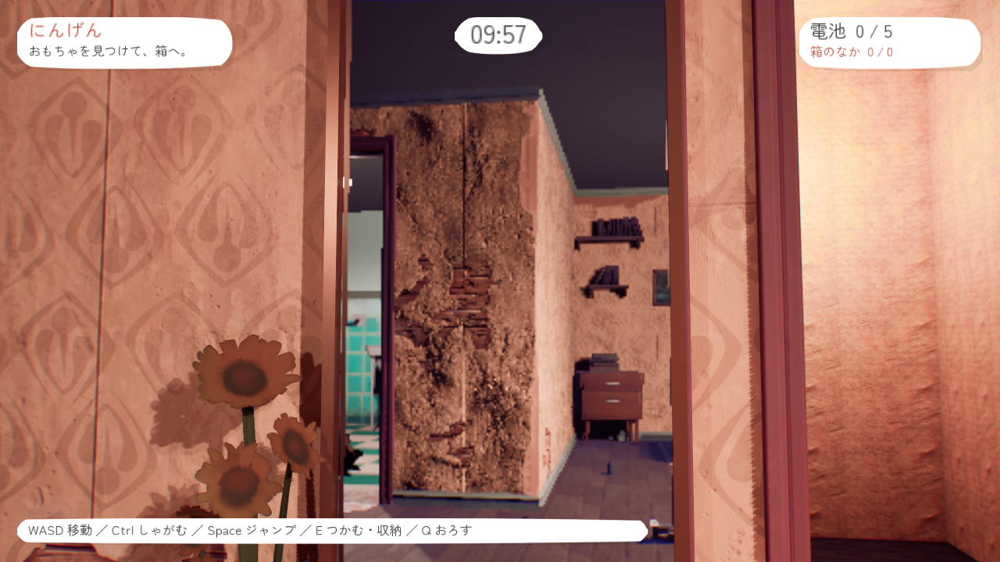

# 鏡

配置するだけで使えるアイテム。Eキーでの操作はない。
人間が鏡に映るおもちゃを見た場合も、サーバーがフリーズを判定する。

## 配置

1. Content Browserで `Items/Mirror/BP_Mirror` をレベルへドラッグする。
2. Actorの原点が鏡面の中央、ローカル **+Xが表側**。表を部屋へ向ける。
3. 標準の鏡面は幅100×高さ160cm。床から立てるなら原点Zを床の高さ+84cm以上にする。
4. 壁に取り付ける場合は、鏡面と壁の間を4cm以上空ける。表側に通路を確保する。
5. 回転と正の拡大縮小に対応。反転目的の負スケールは使わず、Actorを回転する。

`TB_StylizedHouse` には `Gameplay/Mirrors/Mirror_Hallway` を保存済み。
既存の姿見の表面に重ねてあり、元の家具は移動・削除していない。
座標 `(446, -460.68, 164.42)`、Yaw=180度、Scale=`(1, .8, 1.5)`。

## 調整

`Content/Data/DA_Mirror` を編集する。配置したActorの `Mirror Data` に別のDAを指定することもできる。

| 項目 | 初期値 | 内容 |
| --- | --- | --- |
| Width / Height | 100 / 160cm | 鏡面のサイズ。描画と視認判定で共用 |
| Frame Width | 4cm | 枠の幅と本体の厚み |
| View Distance | 1500cm | 視点から鏡の中央までの有効距離。範囲外は鏡面を暗くし、反射による凍結も無効 |
| Capture Width | 512px | 反射映像の横解像度。縦は画面比から決定 |
| Frames Per Second | 30 | 反射映像の最大更新回数。ゲームの判定頻度とは独立 |
| Mirror / Frame Material | 専用素材 | 鏡面と枠。鏡面素材のReflectionTexture等のパラメーターを維持する |

変更後はPlayを開始し直す。描画負荷を抑える場合は、解像度を256px、更新を15回/秒に下げる。
同時に画面へ入る鏡を増やすと追加描画が増える。解像度を下げても、シーンを描くCPU処理はなくならない。

## 判定と描画

- 人間→鏡面→おもちゃの反射経路を求め、両区間の壁・家具と、鏡面の大きさ・向き・人間の視野を検証する。
- おもちゃの頭・中心・足の判定は既存の視認ルールに従う。人間の誰か1人に見られれば止まる。
- 暗室保護は従来どおり。おもちゃがいる部屋と、見ている人間との実際の直線距離で判断する。
- NPCも鏡からおもちゃを発見できる。既存の認識待ち時間・見落とし判定を通り、認識前は凍結させない。
- 反射は1回まで。合わせ鏡や鏡の中の鏡による凍結は扱わず、反射映像にも別の鏡面映像を入れない。
- 映像は各クライアントで生成し、ネット送信しない。サーバーの判定はGPU描画に依存しない。
- 専用サーバーでは鏡映像を生成しない。画面外・裏側・有効距離外では追加描画を停止する。
- カメラを鏡面に対して反転し、画面上の座標で反射テクスチャを表示する。部屋やキャラクターの複製は不要。
- `r.AllowGlobalClipPlane=True` が必要。初回起動では関連シェーダーの生成が発生する。
  Lumenやプロジェクト全体の反射方式は変更していない。

描画は1台のPCにつき1人のローカルプレイヤーを想定。オンラインの別クライアントは各自の視点を使う。
同じ画面のローカル分割プレイは現在非対応。複数PC接続時の実機確認は別途必要。

## 確認

`ToonStory.Mirror.Geometry` は有限な鏡面・裏側・回転・拡大縮小・有効距離を検証する。
`ToonStory.Mirror.Gaze` はサーバーでの凍結・解除、反射経路の両側の遮蔽、暗室保護、NPC認識を検証する。
`ToonStory.Mirror.Placement` は家マップの保存済みDA・素材と、鏡の前に立てる床・空間を検証する。
`ToonStory.Mirror.Visual` は `-MirrorScreenshot` を付けた描画ありのStandalone実行で、
背後の物体と文字を映す確認シーンを `Saved/MirrorPreview/mirror.png` に保存する。
家マップでさらに `-MirrorHouseScreenshot` を指定すると、保存済みの鏡を `Saved/MirrorPreview/house.png` に撮影する。

UE 5.8でビルドと上記テスト、既存の `ToonStory.Items.Conditions`、`ToonStory.NPC.Sight`、
`ToonStory.Playroom.AuthoredContract` の成功を確認済み。実画像でも鏡文字と、家の部屋が映ることを確認した。
本番環境でのGPU負荷・複数台の鏡を同時に表示した場合の性能は未計測。

実機では人間1人・おもちゃ1人以上で、直接見えない位置から鏡越しに見て止まること、
視線を外す／鏡との間に家具を挟むと動けることを確認する。
